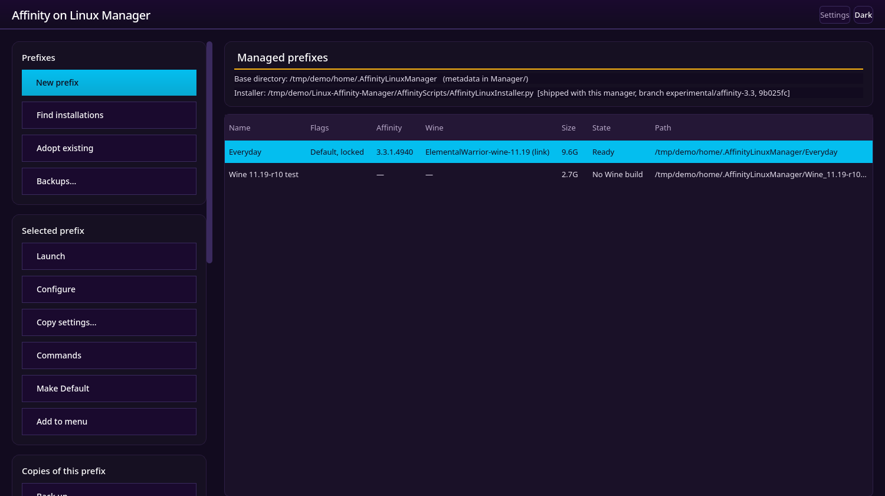

# Affinity on Linux Manager and Affinity Installer

Run Affinity on Linux, and keep several installs side by side: a working
install you cannot afford to break, plus a copy to try a new Wine build or
Affinity release in, backups before an upgrade, or a test copy of a client's
setup.

## Donate Options if you Enjoy this project!

| PayPal | Ko-fi |
|:---:|:---:|
|[](https://paypal.me/gamedev1909)|[](https://ko-fi.com/tlv)|


<details>
<summary><strong>Python GUI Dependencies</strong></summary>

The installer will attempt to install PyQt6 automatically if missing. If automatic installation fails, install it manually:

**Arch/Artix/CachyOS/EndeavourOS/XeroLinux:**
```bash
sudo pacman -S python-pyqt6
```

**Fedora/Nobara:**
```bash
sudo dnf install python3-pyqt6
```

**openSUSE (Tumbleweed/Leap):**
```bash
sudo zypper install python313-PyQt6
```

**PikaOS:** 
```bash
sudo apt install python3-pyqt6.qtsvg
```

**Ubuntu 25.10:** If you encounter GUI issues, also install:
```bash
sudo apt install python3-pyqt6.qtsvg
```

</details>

## Linux Affinity Installer
The installer you are used to.
```bash
curl -sSL https://raw.githubusercontent.com/ryzendew/AffinityOnLinux/refs/heads/main/AffinityScripts/AffinityLinuxInstaller.py | python3
```


## Affinity Manager Installer 
The new Kid on the block with Advanced Features but same Goal!

That starts the manager straight from this repository. It needs Python 3.10 or
newer and PyQt6, and installs nothing on your system.



```bash
curl -sSL https://github.com/jfacemyer/Linux-Affinity-Manager/raw/main/AffinityManager/run.py | python3
```

## What it does

- **New prefix** sets up an Affinity install in its own Wine prefix, through
  **Setup**: the Affinity on Linux installer, run as a page of the manager's
  window. You get Wine with the Affinity patches, the Windows components,
  Affinity itself, GPU rendering, Help, and WineFix.
- **The Default**: choose which install your application menu, double-clicked
  Affinity documents and the Canva sign-in use. Other installs can have menu
  entries of their own.
- **Launch** never starts Affinity twice in one prefix.
- **Back up, restore, clone and snapshot** installs, and copy settings and
  drive letters from one to another.
- **Repairs and tidying**: fonts, the renderer setting, old Wine builds,
  renaming and moving installs, removing them cleanly.
- **One operation at a time** across all installs, with a log for each.

The full guide is the [manager's README](/AffinityManager/README.md).

See the [installer's README](/README.md) for what it sets up, supported
distributions, dependencies and known issues.

Affinity is a commercial product of Serif (Europe) Ltd; you need your own
license to install it. This project is not affiliated with Serif or Canva.
