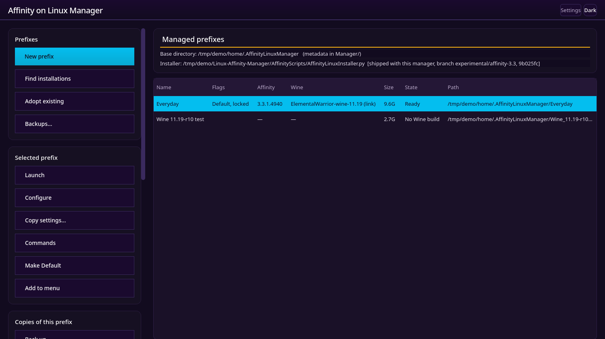

# Affinity on Linux Manager

Keep several Affinity installs on one Linux machine, and decide which one your
desktop uses: a working install you cannot afford to break, plus a copy to try
a new Wine build or Affinity release in; backups before an upgrade; a test copy
of a client's setup.

Each install lives in its own Wine *prefix*: a folder holding a complete
Windows environment with Affinity in it. The manager calls them prefixes.



## Running it

```sh
curl -sSL https://github.com/jfacemyer/Linux-Affinity-Manager/raw/main/AffinityManager/run.py | python3
```

That downloads the manager into `~/.cache/AffinityOnLinux/` and starts it. It
fetches again on every run, so it is always current, and works offline from the
last copy. It installs nothing on your system: no launcher, no package, no
`sudo`. Deleting the cache folder is always safe.

It needs Python 3.10 or newer and PyQt6. If PyQt6 is missing it prints the
command for your distribution; the installer can also install it for you.

From a clone instead:

```sh
git clone https://github.com/jfacemyer/Linux-Affinity-Manager.git
python3 Linux-Affinity-Manager/AffinityManager/AffinityLinuxManager.py
```

## What it does

### Your installs, at a glance

The main window lists every prefix the manager knows, with what is actually in
it: the Affinity version, the Wine build it runs, its size, whether Affinity is
running in it, which one is the **Default**, which have their own menu entry,
and which are protected against deletion. All of it is read from disk each
time, never remembered, so it cannot go stale.

### A new install

**New prefix** asks for a name (it suggests `AffinityLinux YYYY-MM-DD 01`) and
opens **Setup**. Setup is the [Affinity on Linux installer](../README.md): the
manager loads it from the same repository and runs it as a page of its own
window, pointed at the new prefix, so the install is exactly what the installer
does on its own. When the install finishes, the manager offers to make the new
prefix the Default.

**Adopt existing** takes over prefixes already on the machine, such as an
installer's `~/.AffinityLinux`, wherever they are. It can move them into the
manager's folder and fix the launchers that named the old place.

### The Default

Your application menu's **Affinity** entry, double-clicking an Affinity
document in your file manager, and the Canva sign-in can each start only one
prefix. That prefix is the **Default**. **Make Default** moves all three to the
selected prefix in one step, and shows what will change first. Installs made in
the manager leave the Default alone until you choose.

**Add to menu** gives any prefix a menu entry of its own, named after it, so you
can start test copies from the menu too. Double-clicked documents still open in
the Default.

### Starting Affinity

**Launch** starts Affinity in the selected prefix. It refuses to start a second
copy in a prefix where Affinity is already running: under Wine, a second start
closes the first, unsaved work included.

**Commands** lists every way to run a prefix: each Wine build in it with each
way of starting Affinity, plus Wine's configuration, registry editor and
winetricks. Copy a command, run it, or add it to your menu.

### Keeping installs safe

| | What it is | Use it |
|---|---|---|
| **Back up** | An exact copy of the whole prefix, plus the desktop files around it (menu entries, document associations, launchers), kept wherever you choose and never run. | Before an install or an upgrade. **Restore** puts back the prefix, the desktop files, or both. |
| **Clone** | A second, working prefix in the list. | To try something without touching the original. |
| **Snapshots…** | Just the settings: preferences, workspaces, shortcuts, recent files. A few MB. | Before changing settings. |

The backup dialog shows each location's free space and warns when it is on the
same physical disk as the prefix, which would not survive that disk failing. It
refuses locations that cannot hold a prefix, such as FAT or exFAT drives and
`/tmp`. A restore deletes nothing: whatever it replaces is kept aside, so a
restore can itself be undone. **Backups…** lists every backup, including ones on
a disk that is not plugged in.

A clone keeps the prefix's internal links pointing into the copy, so it can
never write back into the original, and it can leave out Wine builds the
prefix does not use (often 3 GB instead of 11).

**Protect** marks a prefix that must not be deleted.

### Settings from one install to another

**Copy settings…** brings preferences, workspaces, shortcuts, recent files and
drive letters (such as a `W:` your projects live on) into a prefix from another
prefix or a folder. Use it after Setup and before Affinity's first start in the
new prefix. A new prefix can also copy them from an existing one as it is
created.

### Repairs and tidying

- **Check fonts** finds fonts that are on disk but not registered, or registered
  from another Wine's folder, and fixes them. Affinity's interface uses the
  wrong typeface otherwise.
- **Renderer**: a prefix that has lost its renderer setting runs Affinity on
  Wine's OpenGL renderer. The manager puts Vulkan back while nothing runs in it,
  and notes it in the prefix's log. A renderer you chose is kept.
- **Clean** reclaims space: Wine builds the prefix no longer uses, downloads
  already unpacked, and Wine's temporary files, each listed with its size. The
  Wine build a prefix runs is never offered.
- **Rename / Move…** renames a prefix or moves it to another disk; its menu
  entries, launchers, log and the Default follow.
- **Delete** lists everything the prefix put on the machine, each item with its
  size, before anything is removed, and never touches files it did not create.

### One thing at a time

Only one install, update or repair runs at a time, across all prefixes. Two
installs at once would collide in the system package manager and in Wine. The
running operation is named at the bottom of the window, with how long it has
taken, and every prefix keeps its own log.

## Where things are kept

```
~/.AffinityLinuxManager/          the base folder (changeable in Settings)
  Manager/
    prefixes.json                 the list of prefixes
    settings.json                 theme, backup location, installer
    logs/                         one log per prefix
    snapshots/                    settings snapshots
    backups.json                  where the backups are
    restores/                     what each restore replaced
  AffinityLinux_2026-10-16_01/    a prefix
  My_Test_Build/                  another
```

Adopted prefixes can stay where they are; the list records their full path.
`$AFFINITY_MANAGER_HOME` overrides the base folder.

## Requirements

- Python 3.10 or newer, and PyQt6
- The Affinity on Linux installer, recent enough to install into a folder it is
  given. Run from the repository or a clone, the one beside the manager is used
  and nothing needs setting up. Settings shows which installer is in use; the
  manager refuses an installer too old to be told where to install.

## Development

This repository is the upstream of the copy in the installer's repository,
`AffinityManager/`. It is carried there with `git subtree`:

```sh
# from the installer's checkout
git subtree pull --prefix=AffinityManager --squash <path-to-this-repo> main
```

The manager loads the installer as a module at run time and copies none of its
code, so the installer stays a single file that can be piped into `python3`.

Run the tests with:

```sh
python3 -m pytest tests/ -q
```

## License

Affinity is a commercial product of Serif (Europe) Ltd; you need your own
license to install it. This project is not affiliated with Serif or Canva.
